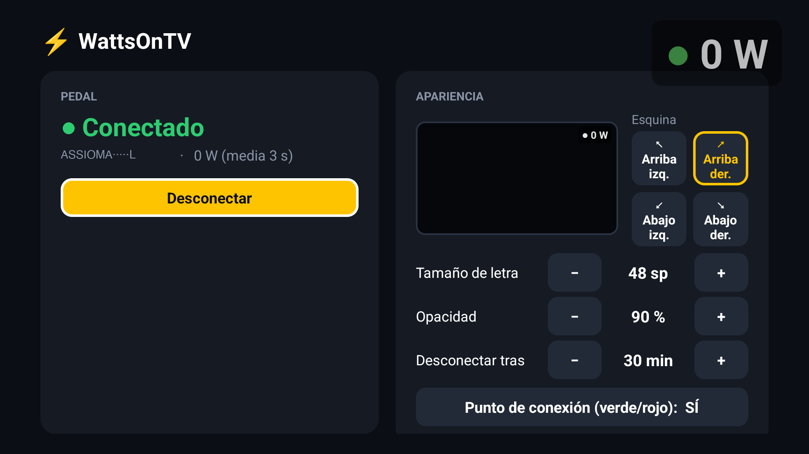

# ⚡ WattsOnTV

**Tus vatios en directo en la tele, dibujados encima de lo que estés viendo.**

WattsOnTV es una app para Android TV / Google TV que se conecta por Bluetooth LE a un medidor de potencia (pedales, bielas, rodillo) y muestra tu **potencia media de 3 segundos** en una esquina de la pantalla, sobre YouTube o cualquier otra app. Está pensada para entrenar en interior: ves un vídeo y tus vatios, sin móvil ni ciclocomputador por medio.

> English: [README.md](README.md)

**[Descargar el último APK](https://github.com/jesus-sayar/WattsOnTV/releases/latest/download/WattsOnTV.apk)** · [Instalar en 4 pasos](#instalación)

## Captura



## Funciones

- Lee la potencia por el servicio BLE estándar **Cycling Power**, así que funciona con los medidores que lo ofrecen.
- Muestra la **media de 3 s ponderada por tiempo**, en cualquiera de las cuatro esquinas.
- Tamaño de letra y opacidad ajustables, con vista previa en vivo en la pantalla de ajustes.
- Punto verde/rojo opcional que indica si el medidor está conectado.
- Muestra `0 W` si no llegan datos durante 3 s (has dejado de pedalear o el sensor se ha dormido).
- Desconexión automática tras N minutos sin potencia (30 por defecto, configurable o nunca), que libera el medidor para otras apps.
- Escanea los medidores y los lista con un botón **Conectar / Desconectar**, como la app de Favero. Sirve para varias bicis: marca el último usado.
- Sin acceso a red, sin cuentas, sin analítica.

## Requisitos

- Un dispositivo Android TV o Google TV con **Android 8.0 (API 26) o superior** (por ejemplo un Chromecast con Google TV).
- Un medidor de potencia que anuncie el servicio BLE **Cycling Power** (`0x1818`) y notifique **Cycling Power Measurement** (`0x2A63`), como los Favero Assioma Duo.

## Instalación

El último APK está siempre en:

**https://github.com/jesus-sayar/WattsOnTV/releases/latest/download/WattsOnTV.apk**

1. Instala **Downloader** (de AFTVnews) desde la tienda de apps de la tele.
2. Ábrela, escribe la dirección de arriba en el cuadro de URL y pulsa **Ir**.
3. Cuando termine la descarga, pulsa **Instalar**. Si Android lo pide, permite a Downloader *instalar apps desconocidas*.
4. Abre **WattsOnTV**.


## Primer uso

1. Abre **WattsOnTV** desde la fila de apps.
2. Si aparece un aviso de permisos, pulsa **Conceder** en:
   - *Mostrar sobre otras apps* (dibuja los vatios en pantalla).
   - *Bluetooth* (buscar y conectar con el medidor).
3. Despierta el medidor girando la biela. Debería aparecer en la lista de la izquierda.
4. Selecciónalo y pulsa **Conectar**. El overlay aparece enseguida, sobre la app que esté abierta.
5. Abre YouTube (o lo que quieras) y pedalea. Pulsa **Desconectar** al acabar, o deja que lo haga el tiempo de inactividad.

Si los ajustes de la tele no dejan conceder *Mostrar sobre otras apps* (pasa en algunas versiones de Google TV), concédelo con adb:

```sh
adb shell appops set app.wattsontv SYSTEM_ALERT_WINDOW allow
adb shell pm grant app.wattsontv android.permission.BLUETOOTH_SCAN
adb shell pm grant app.wattsontv android.permission.BLUETOOTH_CONNECT
adb shell pm grant app.wattsontv android.permission.POST_NOTIFICATIONS
```

Opcionalmente, excluye la app de la optimización de batería para que el sistema no la cierre:
`adb shell dumpsys deviceidle whitelist +app.wattsontv`

## Cómo funciona

```
Medidor --BLE (Cycling Power 0x1818 / 0x2A63)--> WattsOnTV en la tele --overlay--> esquina de la pantalla
```

- **Escaneo:** la pantalla de ajustes busca dispositivos que anuncien `0x1818` y los lista.
- **Conexión:** al pulsar Conectar arranca un servicio en primer plano que se conecta a esa dirección y se suscribe a las notificaciones de Cycling Power Measurement. Si el enlace se cae, reconecta solo hasta que pulses Desconectar.
- **Valor de potencia:** los vatios se leen de los bytes 2-3 de cada notificación (entero de 16 bits con signo, little-endian). El valor mostrado es una media ponderada por tiempo de los últimos 3 segundos.
- **Overlay:** una ventana `TYPE_APPLICATION_OVERLAY` dibujada por el servicio. No recibe foco ni teclas, así que no molesta al mando.

Estructura del código (`app/src/main/java/app/wattsontv/`): `MainActivity` (interfaz), `OverlayService` (overlay y desconexión por inactividad), `PedalScanner`, `PowerBle` (conexión GATT), `PowerParser`, `PowerAverager`, `Prefs`.

## Limitaciones

- **Límite de conexiones.** Muchos medidores admiten un número limitado de conexiones BLE simultáneas. Con unos Assioma Duo, WattsOnTV y la app de Favero no pueden usar los pedales a la vez. ANT+ es otra radio, así que un ciclocomputador que lea el mismo medidor por ANT+ no se ve afectado.
- **Favero Assioma Duo:** solo el pedal izquierdo anuncia el servicio Cycling Power. WattsOnTV conecta con ese y muestra la potencia total que reporta.
- **No sustituye a tu ciclocomputador.** La media de 3 s se calcula en la tele con las notificaciones que recibe, así que no coincidirá exactamente con un ciclocomputador. No hay vueltas, ni grabación, ni equilibrio izquierda/derecha.
- **Sin arranque automático.** Tras reiniciar la tele, abre la app y pulsa Conectar.
- **Visibilidad del overlay.** Android puede ocultar o recolocar las ventanas de overlay en cualquier momento, y algunos diálogos del sistema pueden taparlas.
- **La interfaz está en español.**

## Privacidad

- La app **no** pide el permiso de Internet y no incluye red, analítica ni librerías de terceros.
- Solo guarda tus ajustes de pantalla y la dirección Bluetooth del último medidor, en el almacenamiento privado de la app. Al desinstalar se borra.
- Permisos: mostrar sobre otras apps, Bluetooth (buscar y conectar), servicio en primer plano y notificaciones (necesarios para mantener vivo el overlay).

## Compilar

Requisitos: JDK 17 y el SDK de Android (plataforma 34, build-tools 34.0.0). No hace falta Android Studio.

```sh
echo "sdk.dir=/ruta/al/android/sdk" > local.properties     # no se sube al repositorio
JAVA_HOME=/ruta/al/jdk17 ./gradlew testDebugUnitTest assembleDebug
# APK: app/build/outputs/apk/debug/app-debug.apk
```

Para un APK de release firmado, crea un keystore y un fichero `keystore.properties` (`storeFile`, `storePassword`, `keyAlias`, `keyPassword`; no se sube al repositorio) y ejecuta `./gradlew assembleRelease`.

El wrapper usa Gradle 8.9 con Android Gradle Plugin 8.5.2 y Kotlin 1.9.24. Los tests unitarios cubren el parser de paquetes (con paquetes reales capturados de un Assioma Duo) y la lógica de la media.

## Problemas frecuentes

| Síntoma | Qué mirar |
|---|---|
| El medidor no aparece en la lista | Gira la biela para despertarlo. Cierra otras apps (del móvil, la de Favero) que puedan tener su única conexión BLE. |
| No se dibuja nada en pantalla | No está concedido *Mostrar sobre otras apps*. Usa el comando de adb de arriba. |
| Se queda en "Conectando" o "Reconectando" | El sensor está dormido o fuera de alcance. Gira la biela. |
| Marca `0 W` mientras pedaleas | Mira el punto: rojo significa desconectado. |
| Se pierden los ajustes tras actualizar | Cambiar el ID de la aplicación cuenta como una app nueva. Las actualizaciones normales los conservan. |

## Licencia

[MIT](LICENSE). Puedes usarlo, modificarlo y redistribuirlo, manteniendo el aviso de copyright.

## Aviso legal

No está afiliada ni respaldada por Google, Favero, Garmin ni Samsung. Los nombres de producto se usan solo para describir la compatibilidad.
