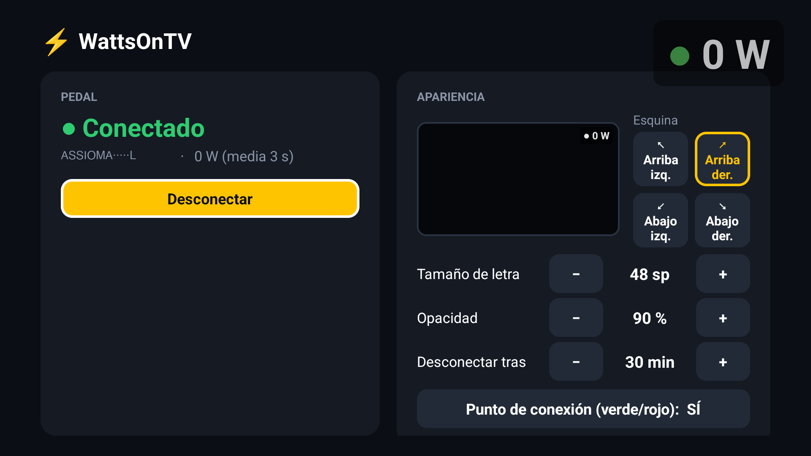

# ⚡ WattsOnTV

**Live cycling power on your TV, drawn on top of whatever you are watching.**

WattsOnTV is an Android TV / Google TV app that connects directly to a Bluetooth LE power meter (pedals, crank, trainer) and shows your **3-second average power** in a corner of the screen, over YouTube or any other app. It is meant for indoor training: watch a video, see your watts, without a phone or a bike computer in the loop.

> Español: [README.es.md](README.es.md)

**[Download the latest APK](https://github.com/jesus-sayar/WattsOnTV/releases/latest/download/WattsOnTV.apk)** · [Install in 4 steps](#install)

## Screenshot



## Features

- Reads power over the standard BLE **Cycling Power** service, so it works with power meters that expose it.
- Shows the **time-weighted 3 s average** in watts, in any of the four corners.
- Adjustable font size and opacity, with a live preview in the settings screen.
- Optional green/red dot showing whether the power meter is connected.
- Shows `0 W` when no data arrives for 3 s (you stopped pedaling or the sensor is asleep).
- Automatic disconnect after N minutes without power (default 30, configurable, or never), which frees the power meter for other apps.
- Scans for power meters and lists them with a **Connect / Disconnect** button, similar to the Favero app. Several bikes are fine: the last one used is marked.
- No network access, no accounts, no analytics.

## Requirements

- An Android TV or Google TV device running **Android 8.0 (API 26) or newer** (for example a Chromecast with Google TV).
- A power meter that advertises the BLE **Cycling Power** service (`0x1818`) and notifies **Cycling Power Measurement** (`0x2A63`), such as the Favero Assioma Duo.

## Install

The latest APK is always at:

**https://github.com/jesus-sayar/WattsOnTV/releases/latest/download/WattsOnTV.apk**

1. Install **Downloader** (by AFTVnews) from the TV's app store.
2. Open it and type the address above in the URL box, then press **Go**.
3. When the download finishes, press **Install**. If Android asks, allow Downloader to *install unknown apps*.
4. Open **WattsOnTV**.


## First run

1. Open **WattsOnTV** from the apps row.
2. If a banner asks for permissions, press **Grant** for:
   - *Display over other apps* (draws the watts on screen).
   - *Bluetooth* (scan and connect to the power meter).
3. Wake the power meter by turning the crank. It should appear in the list on the left.
4. Select it and press **Connect**. The overlay appears immediately, over whatever app is running.
5. Open YouTube (or anything else) and ride. Press **Disconnect** when done, or let the idle timeout do it.

If the TV's settings screen refuses to grant *Display over other apps* (some Google TV builds do), grant it with adb:

```sh
adb shell appops set app.wattsontv SYSTEM_ALERT_WINDOW allow
adb shell pm grant app.wattsontv android.permission.BLUETOOTH_SCAN
adb shell pm grant app.wattsontv android.permission.BLUETOOTH_CONNECT
adb shell pm grant app.wattsontv android.permission.POST_NOTIFICATIONS
```

Optionally exempt it from battery optimization so the system does not kill it:
`adb shell dumpsys deviceidle whitelist +app.wattsontv`

## How it works

```
Power meter --BLE (Cycling Power 0x1818 / 0x2A63)--> WattsOnTV on the TV box --overlay--> corner of the screen
```

- **Scanning:** the settings screen scans for devices advertising `0x1818` and lists them.
- **Connecting:** pressing Connect starts a foreground service that connects to that address and subscribes to Cycling Power Measurement notifications. If the link drops it reconnects on its own until you press Disconnect.
- **Power value:** the watts are read from bytes 2-3 of each notification (signed 16-bit, little-endian). The value shown is a time-weighted average over the last 3 seconds.
- **Overlay:** a `TYPE_APPLICATION_OVERLAY` window drawn by the service. It cannot take focus or key presses, so it does not interfere with the remote.

Source layout (`app/src/main/java/app/wattsontv/`): `MainActivity` (UI), `OverlayService` (overlay, idle timeout), `PedalScanner`, `PowerBle` (GATT connection), `PowerParser`, `PowerAverager`, `Prefs`.

## Limitations

- **Connection limit.** Many power meters accept only a limited number of simultaneous BLE connections. With an Assioma Duo, WattsOnTV and the Favero app cannot use the pedals at the same time. ANT+ is a separate radio, so a bike computer reading the same meter over ANT+ is not affected.
- **Favero Assioma Duo:** only the left pedal advertises the Cycling Power service. WattsOnTV connects to that one and shows the total power it reports.
- **Not a replacement for your bike computer.** The 3 s average is computed on the TV from the notifications it receives, so it will not match a bike computer exactly. There are no laps, no recording and no left/right balance.
- **No auto-start.** After a TV reboot, open the app and press Connect.
- **Overlay visibility.** Android may hide or reposition overlay windows at any time, and some system dialogs can cover them.
- **UI language is Spanish.**

## Privacy

- The app does **not** request the Internet permission and contains no networking, analytics or third-party libraries.
- It stores only your display settings and the Bluetooth address of the last power meter, in its private app storage. Uninstalling removes it.
- Permissions: display over other apps, Bluetooth scan/connect, foreground service and notifications (needed to keep the overlay alive).

## Build

Requirements: JDK 17 and the Android SDK (platform 34, build-tools 34.0.0). No Android Studio is needed.

```sh
echo "sdk.dir=/path/to/android/sdk" > local.properties     # not committed
JAVA_HOME=/path/to/jdk17 ./gradlew testDebugUnitTest assembleDebug
# APK: app/build/outputs/apk/debug/app-debug.apk
```

For a signed release APK, create a keystore and a `keystore.properties` file (`storeFile`, `storePassword`, `keyAlias`, `keyPassword`; not committed) and run `./gradlew assembleRelease`.

The wrapper uses Gradle 8.9 with Android Gradle Plugin 8.5.2 and Kotlin 1.9.24. The unit tests cover the packet parser (with real packets captured from an Assioma Duo) and the averaging logic.

## Troubleshooting

| Symptom | Things to check |
|---|---|
| The power meter does not appear in the list | Turn the crank to wake it. Close other apps (phone apps, Favero app) that may hold its only BLE connection. |
| Nothing is drawn on screen | *Display over other apps* is not granted. Use the adb command above. |
| Stuck on "Connecting" or "Reconnecting" | The sensor is asleep or out of range. Turn the crank. |
| Shows `0 W` while pedaling | Check the dot: red means disconnected. |
| Settings are lost after an update | Changing the application ID counts as a new app. Normal updates keep them. |

## License

[MIT](LICENSE). You can use, modify and redistribute it, keeping the copyright notice.

## Disclaimer

Not affiliated with or endorsed by Google, Favero, Garmin or Samsung. Product names are used only to describe compatibility.
